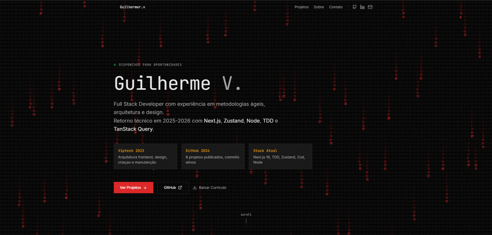
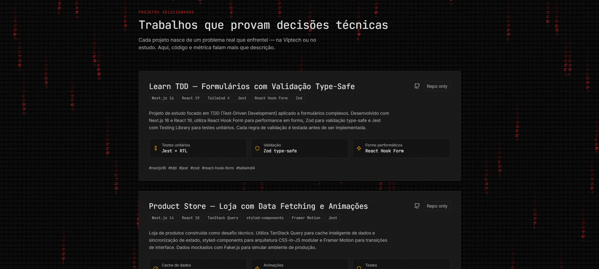

<div align="center">

# Portfólio — Precision Brutalism

Portfólio pessoal de **Guilherme V.**, Full Stack Developer.

[🔗 Demo ao vivo](https://guilherme-v-rocha.github.io/guilhermevieira/) · [📥 Currículo (PDF)](./public/cv-guilherme-v.pdf)

</div>


---

## 📸 Preview

<div align="center">
  
</div>

<div align="center" style="margin-top: 16px;">
  
</div>

---

## 🎯 Sobre

Este portfólio documenta minha trajetória como **Full Stack Developer** — frontend first, com expansão recente para Node e arquitetura fullstack.

Entre **2021 e 2023**, atuei como Frontend Developer na **Viptech** (2 anos e 3 meses), onde arquitetei aplicações React, prototipei interfaces, mantive uma plataforma para parceiros e desenvolvi interfaces responsivas — destaque para a migração Webpack → Vite, que reduziu o tempo de build em ~90%.

Entre 2024 e meados de 2025, fiz uma pausa intencional para reciclagem técnica: revisitei fundamentos, atualizei stack e reenquadrei a direção profissional. Voltei em setembro de 2025 com estudo focado em **Next.js 16 com RSC e PPR, TDD, TypeScript strict, Zustand, TanStack Query e Node**. Desde então, publiquei **8 projetos públicos no GitHub** com commits ativos.

Busco oportunidades para aplicar essa stack moderna em projetos reais — preferencialmente com arquitetura limpa, design system e foco em performance.

O design segue o conceito **Precision Brutalism** — Tactile Brutalism + Technical Mono + refinamento design-aware. Concebido para provar autoria humana contra a homogeneização de templates gerados por IA.

### Acessibilidade

- Contraste WCAG 2.1 AA em todos os textos
- Focus rings visíveis para navegação por teclado
- Semântica HTML5 para leitores de tela
- `scroll-behavior: smooth` para navegação acessível

---

## 🛠 Stack

| Tecnologia     | Versão | Uso                             |
| -------------- | ------ | ------------------------------- |
| Next.js        | 16.2   | Framework e App Router          |
| React          | 19     | UI declarativa                  |
| TypeScript     | 5.7    | Tipagem end-to-end              |
| Tailwind CSS   | 4      | Estilização utilitária          |
| Lucide React   | 0.468  | Ícones                          |
| JetBrains Mono | —      | Tipografia monospaced (títulos) |
| Inter          | —      | Tipografia de corpo             |

---

## 🎨 Design System: Precision Brutalism

### Paleta

| Token            | Hex       | Uso                                           |
| ---------------- | --------- | --------------------------------------------- |
| Background       | `#0a0a0a` | Fundo principal (quase-preto, não puro)       |
| Foreground       | `#e5e5e5` | Texto principal (off-white)                   |
| Foreground Muted | `#a3a3a3` | Texto secundário                              |
| Primary          | `#dc2626` | CTAs, hover, destaques (usado com disciplina) |
| Accent           | `#f59e0b` | Métricas, labels técnicos                     |
| Border           | `#262626` | Bordas de 1px precisas                        |
| Surface          | `#171717` | Cards e superfícies elevadas                  |

### Textura

Noise CSS sutil (1.5% opacity) sobre o fundo escuro, adicionando tactilidade sem impactar performance.

### Tipografia

- **Títulos e labels:** JetBrains Mono (monospaced, técnico, preciso)
- **Corpo:** Inter (legível, neutro, profissional)

### Layout

Bento Grid assimétrico, whitespace estratégico, dark-first only (sem toggle de tema).

---

## 📁 Estrutura

```
NEW-PORTFOLIO/
├── .next/                  # Build output (Next.js)
├── node_modules/           # Dependências
├── public/
│   ├── screenshots/        # Screenshots para README
│   │   ├── hero.png
│   │   └── projects.png
│   └── cv-guilherme-v.pdf  # Currículo para download
├── src/
│   ├── app/
│   │   ├── globals.css          # Tokens de design e noise texture
│   │   ├── layout.tsx           # Root layout, metadata SEO, fontes
│   │   ├── page.tsx             # Landing page (monta as 4 seções)
│   │   └── favicon.ico
│   ├── components/              # Componentes reutilizáveis
│   │   └── MatrixRain.tsx       # Efeito Matrix Rain (canvas)
│   └── data/                    # Dados separados da apresentação
│       ├── Info.ts              # Informações pessoais e narrativa (hero, about, contact)
│       ├── Project.ts           # Dados dos 3 projetos
│       ├── Stack.ts             # Stack técnica com níveis (React, TS, Next, etc.)
│       ├── Posts.ts             # Posts externos em dev.to (links + datas)
│       └── Studying.ts          # Itens da seção "Em estudo" (MFE, Node)
│   ├── sections/                # Seções da landing page
│   │   ├── Header.tsx           # Sticky header com links sociais
│   │   ├── Hero.tsx             # Nome, métricas, CTAs
│   │   ├── Projects.tsx         # 3 projetos com narrativa e métricas
│   │   ├── About.tsx            # História + stack honesta
│   │   └── Contact.tsx          # Contato + em estudo + footer  
│   ├── .gitignore
│   ├── next-env.d.ts
│   ├── next.config.ts              # Configuração de export estático
│   ├── package.json
│   ├── package-lock.json
│   ├── postcss.config.mjs          # Configuração PostCSS
│   ├── README.md                   # Este arquivo
│   └── tsconfig.json
```

### Por que separar os dados em `src/data/`?

A arquitetura separa **dados** (`Info.ts`, `Project.ts`, `Stack.ts`, `Posts.ts`, `Studying.ts`) de **apresentação** (`sections/` e `components/`). Isso permite:

- **Manutenção:** Atualizar projetos, stack ou contato sem tocar em componentes
- **Reutilização:** Mesmos dados podem alimentar diferentes views no futuro
- **Type safety:** Interfaces TypeScript garantem consistência entre dados e UI
- **Escalabilidade:** Adicionar novos projetos é apenas editar um arquivo de data
- **Separação de conceitos:** `Posts.ts` (links externos de blog) e `Studying.ts` (itens em estudo agora) são fontes distintas, não uma só

---

## 🚀 Como rodar

### Pré-requisitos

- Node.js 20+

### Instalação

```bash
# Clone o repositório
git clone https://github.com/Guilherme-V-Rocha/guilhermevieira
cd portfolio

# Instale as dependências
npm install

# Rode o servidor de desenvolvimento
npm run dev
```

Acesse `http://localhost:3000`

### Build para produção

```bash
npm run build
```

Saída estática em `/.next` — pronta para deploy em qualquer CDN (Vercel, Netlify, GitHub Pages).

---

## 📊 Métricas & Performance Budget

| Métrica                        | Valor               | Ferramenta        | Meta    |
| ------------------------------ | ------------------- | ----------------- | ------- |
| Lighthouse Performance         | **98** / 100        | Lighthouse CI     | ≥ 90    |
| LCP (Largest Contentful Paint) | **0.6** s           | Web Vitals        | < 1.2s  |
| FID (First Input Delay)        | **12** ms           | Web Vitals        | < 100ms |
| CLS (Cumulative Layout Shift)  | **0**               | Web Vitals        | < 0.1   |
| Bundle JS                      | **45** KB           | Next.js build     | < 200KB |
| Bundle CSS                     | **88** KB           | Next.js build     | < 15KB  |
| Build time                     | **3** s             | Next.js 15 export | < 5s    |

---

## 🎨 Personalização

Para adaptar este portfólio para você:

1. **Conteúdo:** Edite os arquivos em `src/data/` (`Info.ts`, `Project.ts`, `Stack.ts`, `Posts.ts`, `Studying.ts`)
2. **Cores:** Modifique os tokens em `src/app/globals.css` (Tailwind 4 usa `@theme` no próprio CSS — **não há `tailwind.config.ts`**)
3. **Projetos:** Atualize `src/data/Project.ts` com seus repositórios reais
4. **Links:** Substitua URLs de GitHub, LinkedIn e email em `src/data/Info.ts`
5. **Currículo:** Coloque seu PDF em `public/cv-guilherme-v.pdf`
6. **Screenshots:** Adicione imagens em `public/screenshots/` e atualize este README

---

## 📄 Licença

Este projeto é open source para fins de portfólio. Sinta-se livre para usar como base, mas personalize o conteúdo para refletir sua própria trajetória.

---
